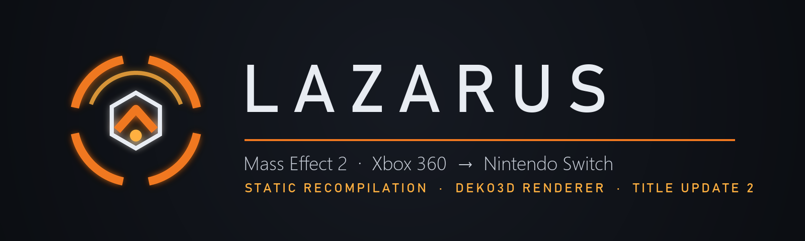
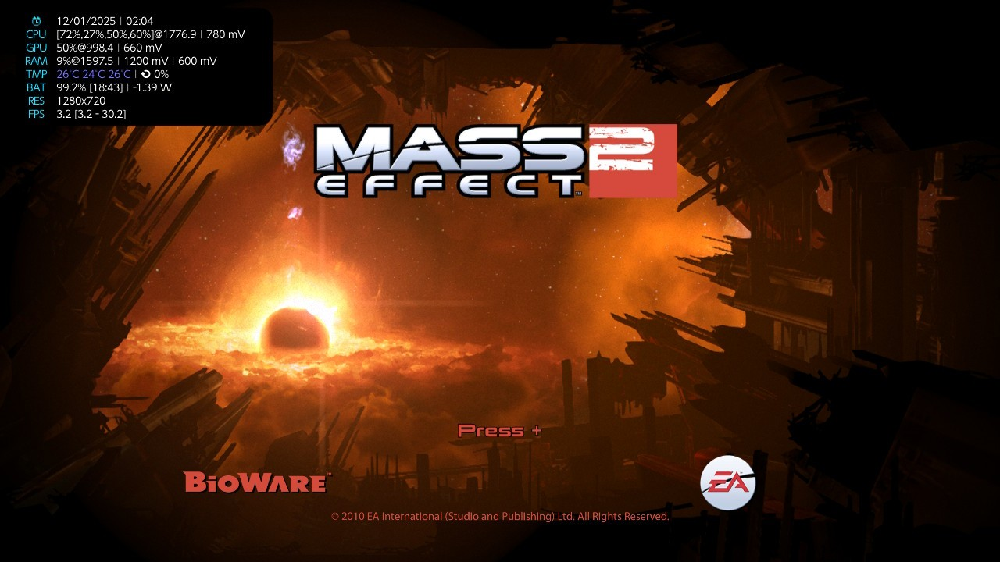
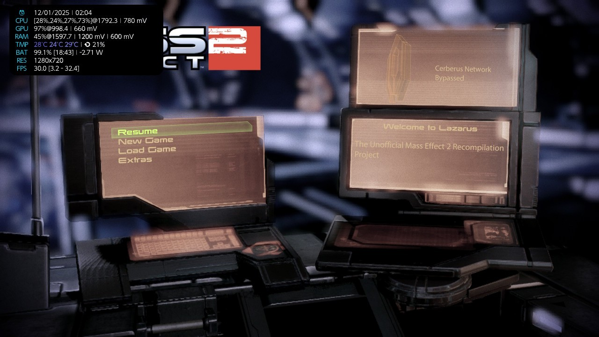
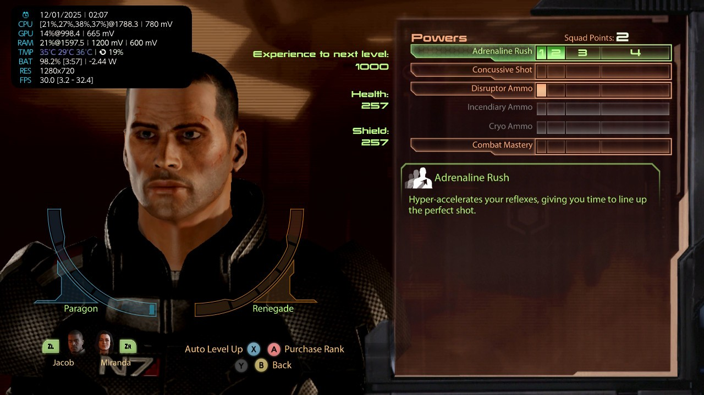
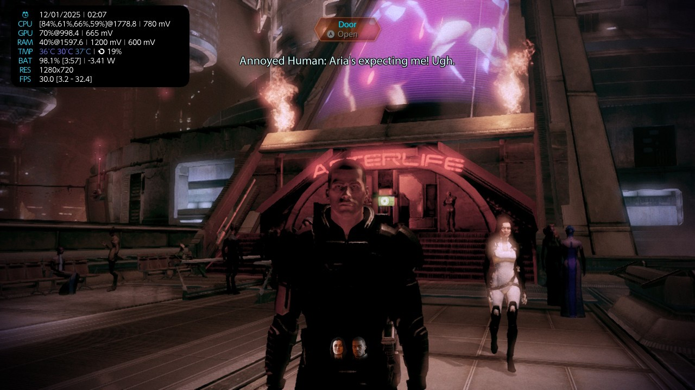
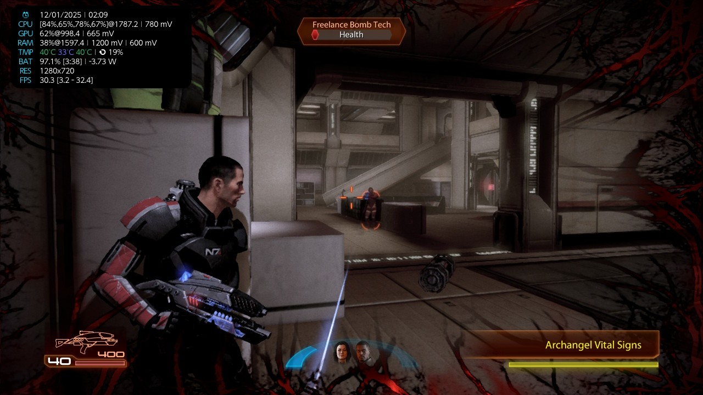
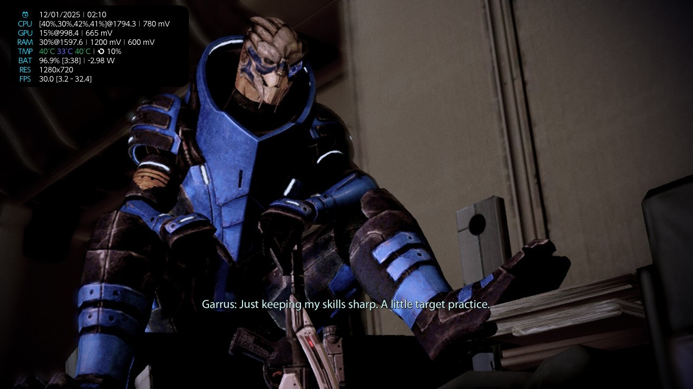
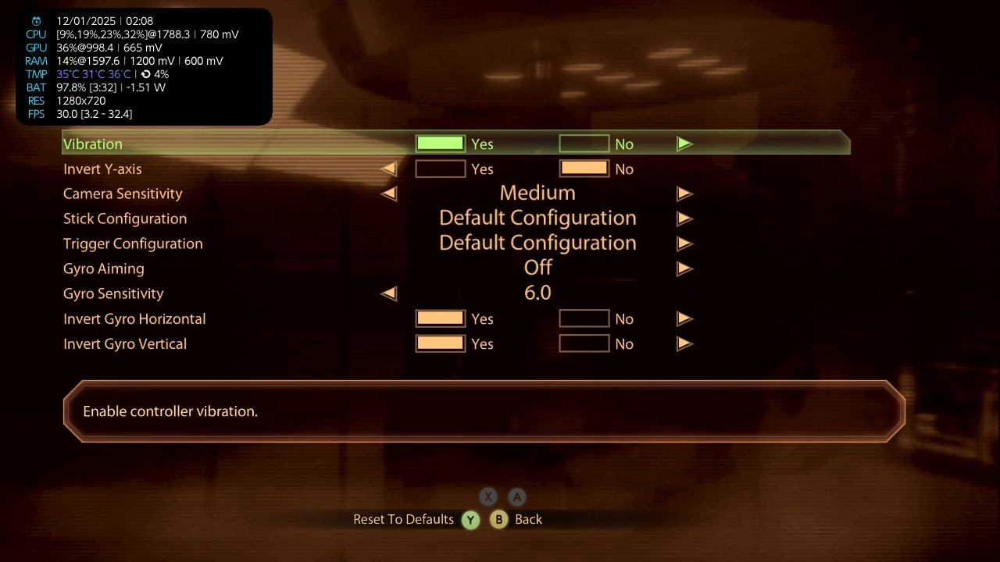
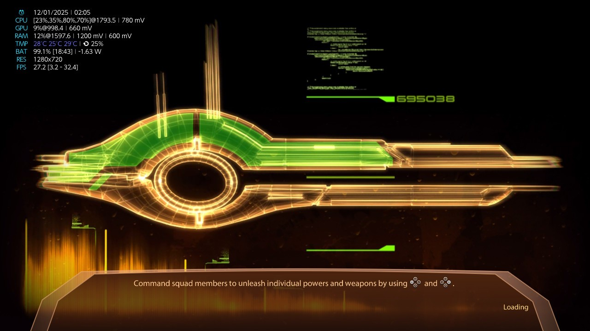

<div align="center">



### BioWare's *Mass Effect 2* (Xbox 360, Title Update 2), statically recompiled for the Nintendo Switch

[](docs/install.md)
[](docs/architecture.md)
[-5cc2f2?style=for-the-badge)](docs/title-update-2.md)
[](docs/known-issues.md)
[](LICENSE)

**[What it is](#-what-it-is)** · **[Known issues](#-known-issues-at-a-glance)** · **[Highlights](#-highlights)** · **[What we fixed](#-what-we-fixed)** ·
**[Screenshots](#%EF%B8%8F-screenshots)** · **[Editions](#-supported-editions)** · **[Install](#-install)** ·
**[Build](#%EF%B8%8F-building-from-source)** · **[Controls](#-controls)** · **[FAQ](#-faq)** ·
**[Troubleshooting](#-troubleshooting)** · **[Roadmap](#%EF%B8%8F-roadmap)** · **[Story](#-how-it-came-back-to-life)** · **[Docs](#-documentation)** ·
**[Credits](#-credits)**

</div>

---

> [!IMPORTANT]
> **No game files are included, and none may ever be added.** Lazarus is made from **your own** Xbox 360 copy of
> *Mass Effect 2* and its Title Update 2. The code generated from the game, the converted shaders and the finished
> NRO are all built on your computer from your files.

## 🧬 What it is

The *Lazarus Project* brought Shepard back. This one does the same for the Xbox 360 version of Mass Effect 2:

- **Static recompilation.** The game's PowerPC program (`default.xex` + the TU2 patch) is translated to C++ by the
  [ReXGlue](https://github.com/rexglue/rexglue-sdk) code generator and compiled for the Switch's ARM CPU. No emulator
  runs at play time: the Xbox 360 kernel, file system, audio (XMA) and input are provided by the SDK's runtime.
- **A Direct3D-level renderer on deko3d.** Instead of emulating the Xenos GPU, *Renut* hooks the game's own Direct3D
  calls (draws, shaders, render targets, resolves) and replays them through [plume](https://github.com/renderbag/plume)
  on deko3d, the Switch's native graphics API. The game's ~38,700 shaders are converted ahead of time
  (Xenos microcode → SPIR-V → GLSL → DKSH).
- **Game-specific work on top:** Umbra occlusion answers, size-based culling, native replacements for hot functions,
  PGO builds, Switch button glyphs, gyro aiming, a working ME1 character import and more (see below).

It runs on a real Switch and in Ryujinx. It is a work in progress: read **[known issues](docs/known-issues.md)** before
you start a long playthrough.

## 🚧 Known issues at a glance

> [!WARNING]
> - **Heavy hubs and big fights are not a locked 30.** Entering the location for the first time, heavy sceanes like Kasumi's party,
>   action-packed combat (many enemies, powers and effects at once) can drop into the high teens or low 20s fps:
>   the game's own render thread is the limit there, and long heavy stretches can bring short audio dropouts. For now,
>   the fix is to overclock the console above the clocks the profiles were tuned for.
> - **You build it yourself, for Title Update 2 only.** There is no download; the NRO and shader files are made from
>   your own discs and TU2 package, and the build chain has not yet been re-run from a fresh clone.
> - **Some picture features are off:** the game's 2x MSAA and the lens flares, and size culling can make distant lights
>   pop in.
> - **No online, no restart:** the Cerberus Network and store do not exist, and where the Xbox would restart the game
>   (signing out, some import failures) the port stays where it is.
>
> The full list: **[docs/known-issues.md](docs/known-issues.md)**.

## ⚡ Highlights

<div align="center">

| | Feature | What it does |
| :---: | :--- | :--- |
| 🎨 | **Native deko3d renderer** | The game's Direct3D calls drawn by deko3d: no GPU emulation, no Vulkan driver in the NRO |
| 👁️ | **Umbra occlusion answers** | ME2's occlusion middleware gets real answers: the Omega hub's heaviest spot went from **16 to 27 fps** |
| ✂️ | **Size-based culling** | Small far objects and lights skipped by their size on screen |
| 🔥 | **Hot natives + PGO** | Hand-written C++ for the hottest guest functions (each checked against the original), profile-guided builds |
| 🎮 | **Switch button glyphs** | Every Xbox button icon and prompt replaced, including the conversation interrupts (LT/RT → ZL/ZR) |
| 🎯 | **Gyro aiming** | Hold ZL and aim with motion; options rows in *Options → Controller* |
| 🧬 | **ME1 character import** | Pick an ME1 save (PC `.MassEffectSave` or Xbox save) from the game's own load screen: no restart |
| 💬 | **Subtitle size** | 100-200 %, live, in *Options → Gameplay* |
| 💾 | **Switch user saves** | With the NSP forwarder the game saves into the chosen Switch user's save data |
| 📦 | **DLC and Title Update 2** | Installed DLC is mounted; TU2's fixes and its update text files are applied |
| 🇷🇺 | **Russian edition** | On its own (disc or Games on Demand dump) or as a ~30 MB overlay on the English game, with translated option rows |

</div>

### 📊 Measured

Real Switch, fidelity profile at 540p, CPU 1785 / GPU 998 MHz (logs of 2026-11-03): gameplay **median 29.4 fps**,
48 % of the 10-second windows at 30. The heaviest hubs (Omega, Kasumi's loyalty party) still drop into the high teens
or low 20s: there the game's own render thread is the limit. The *performance* profile is tuned for stock clocks
(handheld CPU 1020 / GPU 460.8 MHz). How to measure your own runs: **[docs/measuring.md](docs/measuring.md)**.

## 🔧 What we fixed

Every row was found in a console or Ryujinx log, a RenderDoc capture or a crash stack, and checked on the PC build,
in Ryujinx or on a real Switch.

<div align="center">

| | Problem | Cause | Result |
| :---: | :--- | :--- | :--- |
| 👁️ | Everything in view drawn, also behind walls | Umbra's occlusion queries were always answered "visible" | Omega's heaviest spot **16 → 27 fps** |
| ✂️ | Thousands of specks and far lights drawn | No size limit on small objects and lights | **+2.7 %** fps standing in a busy party, ~7 % of instances skipped |
| 🌗 | Half-black faces | The XDK shifts 2x MSAA viewports by a quarter pixel; lighting depth tests failed on slopes | faces lit correctly |
| ☀️ | Scene too bright and washed out | Colour textures carry the Xenos gamma flag, which was ignored | colours as on the Xbox 360 |
| 🌫️ | Washed-out menus, black depth-of-field backgrounds | UE3 reads its HDR scene through other EDRAM formats and a 4x MSAA view | menus and DOF right |
| 🧑‍🚀 | Black patches on characters (deko3d) | Depth-test ties between a character's passes | patches gone |
| 👀 | Dark rings around eyes, black faces up close | Stale pixel constants in the DOF / bloom pass | correct (constant deltas off) |
| ✨ | Particles vanishing now and then | Xenos computes 0 × ∞ = 0, the Switch GPU NaN | XenosRecomp follows the Xbox rule in those shaders |
| 💿 | Hang when the game asks for disc 2 | `XamSwapDisc` waited forever | both discs play from one folder |
| ⏱️ | 11 s at every start before the first frame | The shader cache was walked record by record | an index file, read at once |
| 🧬 | ME1 import impossible, then a crash after backing out | The Xbox needs a second program and a restart | the PC route in the game's own load screen; the restart skipped |

</div>

## 🖼️ Screenshots

Captured on a real Switch (handheld, 1280x720, CPU ~1785 / GPU 998 MHz). The overlay in the corner shows the clocks
and the frame rate.

<div align="center">

| | |
| :---: | :---: |
|  |  |
| **Title screen** | **Main menu**: the offline Cerberus terminal welcomes you to Lazarus |
|  |  |
| **Squad screen**: Switch button glyphs, ZL / ZR to change squad member | **Omega**, outside Afterlife, at 30 fps |
|  |  |
| **Combat**: recruiting Archangel | **Conversation**: Garrus, with subtitles |
|  |  |
| **Options → Controller**: the new gyro rows | **Loading screen** |

</div>

## ✅ Supported editions

Lazarus is built for the **Xbox 360** release (title ID `454108CE`) with **Title Update 2**. The NRO must be built from
the same `default.xex` + `default.xexp` you play with.

<div align="center">

| Edition | Base `default.xex` | With TU2 | Status |
| :--- | :---: | :---: | :--- |
| English / Spanish (one TU2 package for both) | 0.0.0.1 | 0.0.2.1 | ✅ played on console and in Ryujinx |
| Russian | 0.0.0.6 | 0.0.2.6 | ✅ played on console; on its own or as an overlay ([how](docs/install.md#russian)) |
| French, German, Italian, Polish | | | ❔ own TU2 packages, not tested yet |
| Without Title Update 2 | 0.0.0.x | | ❌ not supported (TU2 moved every address) |

</div>

`me2.log` names the version at start: `XEX patch applied: 0.0.0.1 -> 0.0.2.1`.

## 📦 Install

The full guide, with the SD card layout, Ryujinx and the forwarder, is **[docs/install.md](docs/install.md)**. In short:

1. **Build the NRO and its shader files from your game** ([building](#%EF%B8%8F-building-from-source)). There are no
   prebuilt downloads: every file that comes from the game has to be made from your own copy.
2. Copy the game (both discs merged, plus TU2) and the build to `sdmc:/switch/me2-deko/`.
3. Pick a settings profile from [`config/profiles`](config/profiles) and copy it as `me2.toml`.
4. Start `me2_opt.nro` **with full memory** (hold **R** while starting a game), or install the
   [NSP forwarder](docs/forwarder.md), which also unlocks the 4th CPU core and Switch user saves.

```text
sdmc:/switch/me2-deko/
  ├── me2_opt.nro                    ← tools/nx/build_switch.sh
  ├── me2.toml                       ← config/profiles/<en|ru>/<performance|fidelity>/me2.toml
  ├── deko3d_glsl.bin                ← the game's shaders (from your game)
  ├── deko3d_shaders.bin (+ .idx)    ← precompiled shader variants (from your game)
  ├── game/                          ← your game: both discs merged, TU2's default.xexp and update/*.tlk
  ├── me2/                           ← DLC and user data
  └── ME1/                           ← (optional) ME1 saves to import
```

## 🛠️ Building from source

The step-by-step guide is **[docs/building.md](docs/building.md)**. The outline:

```sh
# 0. Source and the third-party libraries the repository does not carry
git clone https://github.com/VibePorter/Lazarus.git && cd Lazarus
python tools/fetch_thirdparty.py          # SDK libraries (ReXGlue v0.10.0 and its submodules)
python tools/fetch_app_thirdparty.py      # plume / XenosRecomp submodules (Vulkan headers, DXC, zstd, ...)

# 1. Windows: your game into assets/game_root (+ TU2's default.xexp), the code generator, the C++ of the game
powershell -File tools\codegen.ps1 -Flavor optimised

# 2. Windows: the game's shaders (Xenos -> SPIR-V -> GLSL / DKSH), see docs/building.md "Shaders"

# 3. WSL / Linux: the Switch NRO (devkitA64)
sudo bash tools/nx/setup_wsl.sh
SHADER_CACHE_CPP=... GLSL_DIR=... DKSH_DIR=... bash tools/nx/build_switch.sh
```

## 🎮 Controls

The game's Xbox layout maps to the Switch **by letter for A and B** and **by position for X and Y**, and the on-screen
glyphs follow:

| Switch | Xbox 360 pad | | Switch | Xbox 360 pad |
| :--- | :--- | --- | :--- | :--- |
| **A** / **B** | A / B | | **L** / **R** | LB / RB |
| **Y** (left) | X (left) | | **ZL** / **ZR** | LT / RT (interrupts: ZL / ZR) |
| **X** (top) | Y (top) | | **+** / **−** | Start / Back |
| **ZL** + motion | gyro aim | | **L + R + X / Y** | gyro sensitivity up / down |

## ❓ FAQ

<details>
<summary><b>Where is the download?</b></summary>

There is none, and there will not be one with game content in it. The NRO contains code translated from the game,
and the shader files are made from the game's shaders, so you build both from your own copy
([docs/building.md](docs/building.md)).
</details>

<details>
<summary><b>Does it run on an unmodified Switch?</b></summary>

No. It is homebrew: you need a console running Atmosphère. The NSP forwarder also needs sigpatches.
</details>

<details>
<summary><b>Can I use the PC, PS3 or Legendary Edition files?</b></summary>

No. Lazarus is the Xbox 360 program, and it needs the Xbox 360 discs and Title Update 2. Other versions have
different program code and data formats.
</details>

<details>
<summary><b>Can I continue my Xbox 360 or PC save?</b></summary>

Yes. An Xbox 360 save is an STFS package: extract it with `python tools/stfs_extract.py <package> <folder>`, and the
`.xbsav` inside works as it is. PC saves (`.pcsav`) convert with
`python tools/me2_save_convert.py <in.pcsav> <out.xbsav>`, which needs Gibbed's save editor sources in `tools/ext`
(`git clone https://github.com/gibbed/Gibbed.MassEffect2 tools/ext/Gibbed.MassEffect2`). Put the `.xbsav` in a career
folder under `me2/<profile>/454108CE/00000001/` (the game creates it at its first save). With the
[forwarder](docs/forwarder.md) the saves live in the Switch user's save data instead.
</details>

<details>
<summary><b>Can I bring my Mass Effect 1 Shepard?</b></summary>

Yes, from a PC or Xbox 360 ME1 save: [docs/me1-import.md](docs/me1-import.md).
</details>

<details>
<summary><b>Switch Lite / OLED / docked?</b></summary>

Any Switch that runs Atmosphère should work; handheld and docked are both supported, docked at a higher resolution
(see [docs/configuration.md](docs/configuration.md)).
The profiles are tuned for stock clocks (performance) or an overclocked console (fidelity).
</details>

<details>
<summary><b>Should I play in Ryujinx?</b></summary>

Ryujinx is for testing and debugging. It runs the port, but the console is the target and the profiles are tuned for
it. Ryujinx needs two extra settings ([docs/install.md](docs/install.md#ryujinx)).
</details>

## 📜 How it came back to life

About two weeks from the first NRO to the version in this repository. The full story:
**[docs/timeline.md](docs/timeline.md)**.

- **Before:** ME2's Xbox 360 program recompiled for Windows first; by 24 October it booted, saved and loaded DLC.
- **24 Oct:** the first Switch NRO, on masseffect-nx's Vulkan (NVK) route: main menu on a real Switch, then in game at
  13-15 fps, and a hang in Eden. That evening: mgr-nx-deko shows a renderer on deko3d without a Vulkan driver.
- **25 Oct:** the switch to deko3d. First picture from Renut on the PC in the afternoon, the title screen in Ryujinx
  in the evening, **running on a real Switch that night** (12-15 fps).
- **26-27 Oct:** optimised codegen, Cinnamon's ideas and the 4th CPU core: heavy scenes 13-16 → 26-30 fps. Picture
  fixes, FXAA + FSR, PGO, Switch glyphs, real occlusion queries.
- **28-31 Oct:** Umbra answered without waiting (Omega 16 → 27 fps), the vanishing particles fixed, the Russian edition.
- **1-2 Nov:** UE3's render thread in the cross-hairs; naruto-nx ports and size culling; the ME1 import worked out.
- **3 Nov:** median 29.4 fps in gameplay (540p, overclocked); the port moves to **Title Update 2**; gyro aiming.
- **4 Nov:** subtitle size, the import crash fixed, and the port becomes **Lazarus**.

## 📚 Documentation

| Guide | |
| :--- | :--- |
| [install.md](docs/install.md) | SD card layout, game files, profiles, Ryujinx |
| [building.md](docs/building.md) | Everything from your disc to the NRO |
| [configuration.md](docs/configuration.md) | The profiles and the settings worth knowing |
| [me1-import.md](docs/me1-import.md) | Importing a Mass Effect 1 Shepard |
| [title-update-2.md](docs/title-update-2.md) | What TU2 changes and how the port follows it |
| [forwarder.md](docs/forwarder.md) | The HOME-menu NSP: 4th core, user saves |
| [architecture.md](docs/architecture.md) | How the port works, folder by folder |
| [debugging.md](docs/debugging.md) | Logs, crash stacks, Ryujinx |
| [measuring.md](docs/measuring.md) | The performance report and how to read it |
| [known-issues.md](docs/known-issues.md) | What does not work yet |
| [timeline.md](docs/timeline.md) | How the port came together, day by day |
| [nvk-route.md](docs/nvk-route.md) | The first attempt (NVK / Vulkan), kept for reference |

## 🙏 Credits

Lazarus stands on the work of many people. Licenses and the exact files each project contributed:
**[THIRD_PARTY_NOTICES.md](THIRD_PARTY_NOTICES.md)** and **[UPSTREAM_SA2_NOTICES.md](UPSTREAM_SA2_NOTICES.md)**.

**The ports this one grew from**

- **[mgr-nx-deko](https://github.com/tuancapoo/mgr-nx-deko)** by tuancapoo: the tree Lazarus started from (the deko3d
  build, Renut retargeted to another game, the tooling around it)
- **[sa2-nx](https://github.com/ChanseyIsTheBest/sa2-nx)** by ChanseyIsTheBest: the renderer integration, the
  application structure and most of the build and analysis scripts
- **banjo-nx** by ChanseyIsTheBest (Banjo-Kazooie: Nuts & Bolts): Renut's deko3d tuning, plume's deko3d back end, the
  device layout Renut was written for
- **[reNut](https://github.com/masterspike52/reNut)** by masterspike52: the Direct3D-level renderer itself
- **[masseffect-nx](https://github.com/nebadasSwifty/masseffect-nx)** by NebadasSwifty: the Mass Effect recompilation
  base, the native renderer, the shader scanner, the CPU enhancement and native-function framework
- **[nfsmw-nx](https://github.com/StevensND/nfsmw-nx)** by StevensND: the SDK's Horizon (Switch) layer, the profiling
  and PGO method, the toolchain file and several scripts
- **[NFSMW Recompiled](https://github.com/madelrandel-blip/NFSMW-Recompiled)** by madelrandel-blip: the recompilation
  project the ports above started from

**Ports we learned from and borrowed fixes from**

- **[Mass Effect Cinnamon](https://github.com/jvankooo/masseffect-cinnamon)** by jvankooo: gyro aiming, and this
  README's layout
- **[naruto-rise-of-a-ninja-nx](https://github.com/malinkin-s/naruto-rise-of-a-ninja-nx)** by malinkin-s: plume bind
  caches, draw batching, record-worker findings
- **[mk9-nx](https://github.com/Thorhax/mk9-nx)** by Thorhax: performance ideas (critical-section spinning, heap and deko3d memory tuning)
- **[ds2-nx](https://github.com/VasilkovND/ds2-nx)** by VasilkovND: XMA wake-up and thread yield fixes in the SDK
- **[Silent Hill: Downpour Switch](https://github.com/fungalspores/silent-hill-downpour-switch)** by fungalspores: the
  first (NVK) attempt's app layer
- **[prototype-switch](https://github.com/fungalspores/prototype-switch)** by fungalspores: the NSP forwarder packer and
  the codegen preparation step
- **sasrt-nx**, **futari-nx**, **peggle2-nx** and **UnleashedRecomp-NX**: post-codegen passes, the frame latency
  probe, the HLSL front end and plume's Switch changes, as they reached us through sa2-nx and banjo-nx

**Recompilation and runtime**

- **[ReXGlue SDK](https://github.com/rexglue/rexglue-sdk)** by Tom Clay and contributors: the code generator and
  runtime
- **[Xenia](https://xenia.jp)** by Ben Vanik and the Xenia contributors, and
  **[xenia-canary](https://github.com/xenia-canary/xenia-canary)**: the Xbox 360 kernel and GPU knowledge in the SDK,
  and the GPU fixes ported from canary
- **[libnx](https://github.com/switchbrew/libnx)** (switchbrew) and **[devkitPro](https://devkitpro.org)**
  (devkitA64, newlib, the Switch portlibs)
- **[FFmpeg](https://ffmpeg.org)**: XMA and WMA audio decoding; **[libmspack](https://www.cabextract.org.uk/libmspack/)**
  by Stuart Caie: LZX decompression

**Graphics and shaders**

- **[plume](https://github.com/renderbag/plume)** by renderbag and contributors: the graphics API layer
  (deko3d, Vulkan, D3D12)
- **[deko3d](https://github.com/devkitPro/deko3d)** and **[uam](https://github.com/devkitPro/uam)** by fincs, with
  SwitchWakerHD's patches; Mesa's nouveau compiler inside uam
- **[XenosRecomp](https://github.com/hedge-dev/XenosRecomp)** by hedge-dev and contributors (and the reblue fork):
  Xenos shaders to HLSL / SPIR-V; **[UnleashedRecomp](https://github.com/hedge-dev/UnleashedRecomp)**, where much of
  this toolchain began
- **[DirectXShaderCompiler](https://github.com/microsoft/DirectXShaderCompiler)** (Microsoft, via
  [dxc-bin](https://github.com/renderbag/dxc-bin)), **[SPIRV-Cross](https://github.com/KhronosGroup/SPIRV-Cross)**,
  **[glslang](https://github.com/KhronosGroup/glslang)**, **[SPIRV-Tools](https://github.com/KhronosGroup/SPIRV-Tools)**
  and **[SPIRV-Headers](https://github.com/KhronosGroup/SPIRV-Headers)** (Khronos)
- **[smol-v](https://github.com/aras-p/smol-v)** by Aras Pranckevičius: SPIR-V compression
- **[FSR 1](https://github.com/GPUOpen-Effects/FidelityFX-FSR)** (AMD FidelityFX) and **FXAA 3.11** (NVIDIA): the final
  upscale and anti-aliasing
- **[Vulkan-Headers](https://github.com/KhronosGroup/Vulkan-Headers)**,
  **[volk](https://github.com/zeux/volk)** by Arseny Kapoulkine,
  **[Vulkan Memory Allocator](https://github.com/GPUOpen-LibrariesAndSDKs/VulkanMemoryAllocator)** and
  **[D3D12 Memory Allocator](https://github.com/GPUOpen-LibrariesAndSDKs/D3D12MemoryAllocator)** (AMD GPUOpen): the PC
  build's graphics back ends

**Libraries**

- **[fmt](https://github.com/fmtlib/fmt)**, **[spdlog](https://github.com/gabime/spdlog)**,
  **[toml++](https://github.com/marzer/tomlplusplus)**, **[CLI11](https://github.com/CLIUtils/CLI11)**,
  **[utfcpp](https://github.com/nemtrif/utfcpp)**
- **[xxHash](https://github.com/Cyan4973/xxHash)** by Yann Collet, **[Zstandard](https://github.com/facebook/zstd)**
  (Meta), **[SIMDe](https://github.com/simd-everywhere/simde)**, **[o1heap](https://github.com/pavel-kirienko/o1heap)**
  by Pavel Kirienko
- **[Dear ImGui](https://github.com/ocornut/imgui)** by Omar Cornut, **[stb](https://github.com/nothings/stb)** by
  Sean Barrett (PNG decoding for the ME1 import)
- **[aes_128](https://github.com/openluopworld/aes_128)** by LuoPeng, **[tiny-AES-c](https://github.com/kokke/tiny-AES-c)**,
  disruptorplus, the RenderDoc API header, and the PowerPC disassembler shipped with ReXGlue
- PC build and tests only: **[SDL3](https://www.libsdl.org)**, **[MoltenVK](https://github.com/KhronosGroup/MoltenVK)**,
  the Vulkan loader, **[Catch2](https://github.com/catchorg/Catch2)**

**Tools and know-how**

- **[Gibbed.MassEffect2](https://github.com/gibbed/Gibbed.MassEffect2)** by Rick (gibbed): the save format behind the
  save converter
- **[Forwarder-Mod](https://github.com/Skywalker25/Forwarder-Mod)** (nx-hbloader authors): the NSP forwarder's loader
- **Ryujinx** and **Eden**: testing without a console; **[RenderDoc](https://renderdoc.org)** by Baldur Karlsson: frame captures on the PC build
- **[Atmosphère](https://github.com/Atmosphere-NX/Atmosphere)**: running homebrew on the console

## ⚖️ Legal

Lazarus is an unofficial fan project, not affiliated with or endorsed by BioWare, Electronic Arts, Microsoft or
Nintendo. *Mass Effect* is a trademark of EA International (Studio and Publishing) Ltd. You need your own legally
obtained copy of the game. The port's own code is GPL-3.0 ([LICENSE](LICENSE)); the SDK is BSD-3-Clause, and the
third-party parts keep their licenses ([THIRD_PARTY_NOTICES.md](THIRD_PARTY_NOTICES.md)).
